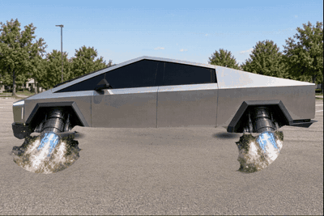
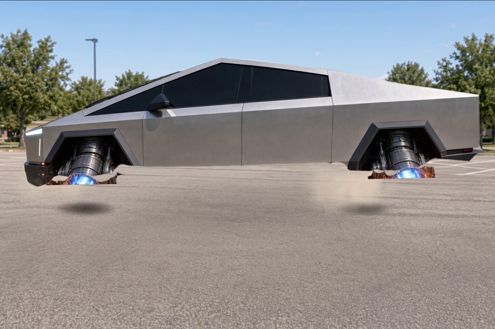

# Truck hovering away

Turns the still photo `assets/source_truck.jpeg` into a short 3D-accurate shot of
the vehicle lifting off its rocket thrusters, hovering, and flying away into the
distance.

**Deliverable:** [`output/truck_hovering_away.mp4`](output/truck_hovering_away.mp4)
— 7.5 s, 1440×960, 30 fps, H.264 + AAC (synthesised rocket rumble).





## How it was built

No video model was available in this environment, so the shot is a **2.5D
composite** built from the original photograph:

1. **Background plate** – the same scene with the vehicle removed was
   regenerated (image-edit pass) so the vehicle has somewhere to fly away
   *to*. The plate is registered back onto the source photo.
2. **Vehicle sprite** – a hand-measured outline of the truck, refined with
   GrabCut so the alpha follows the real panel edges to the pixel. The dark
   bodywork (rocker, bumpers, wheel arches) is seeded explicitly, otherwise
   GrabCut mistakes it for the ground shadow.
3. **Thruster fire** – recovered with a colour model (hot orange core +
   blue-white plume), split into a *cone* that stays welded to the nozzle and
   a *ground fireball* that burns out where the vehicle took off.
4. **Animation** – the vehicle is driven by three numbers per keyframe
   (`bottom`, `scale`, `dx`); `dy` is derived so the wheels land exactly on
   `bottom`. Ground shadow, take-off dust, a hanging smoke trail, camera
   shake and bloom are layered on top.
5. **Audio** – brown-noise rumble, a low engine sweep, band-passed hiss with
   flicker, lift-off thumps and an acceleration whoosh, all synthesised with
   numpy/scipy.

## Pipeline

```bash
python -m venv .venv && .venv/bin/pip install -r requirements.txt

.venv/bin/python scripts/sprites.py    # cut the vehicle + fire out of the photo
.venv/bin/python scripts/animate.py    # render frames/seq/f%04d.png
.venv/bin/python scripts/audio.py      # synthesise output/rocket.wav

ffmpeg -framerate 30 -i frames/seq/f%04d.png -i output/rocket.wav \
  -c:v libx264 -preset slow -crf 17 -pix_fmt yuv420p -movflags +faststart \
  -c:a aac -b:a 192k -shortest output/truck_hovering_away.mp4
```

`scripts/animate.py --preview` renders a handful of key frames for quick
iteration instead of the full 225.

## Layout

| path | what |
| --- | --- |
| `assets/source_truck.jpeg` | the input photograph |
| `assets/background_plate.png` | empty parking lot the vehicle flies away from |
| `assets/truck_rgba.png` | cut-out vehicle sprite (generated) |
| `assets/fire_rgba.png` | thruster flame sprite (generated) |
| `scripts/` | segmentation + animation + audio |
| `output/` | the mp4, a poster frame and the wav stem |
